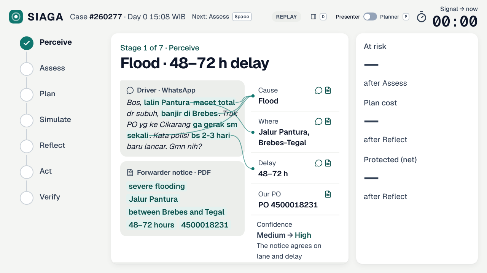
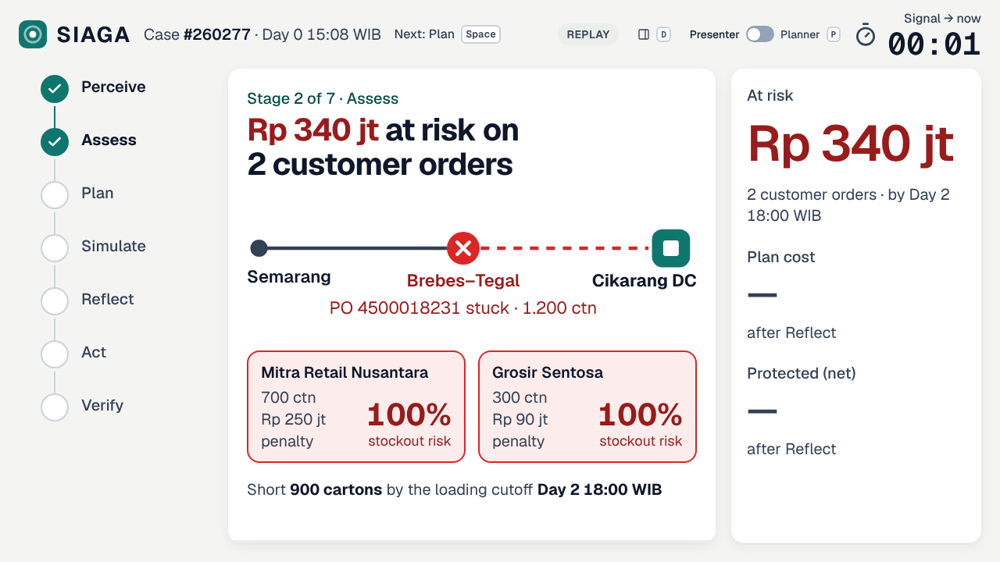
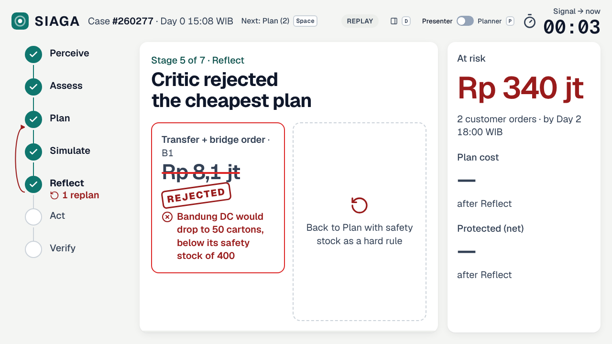
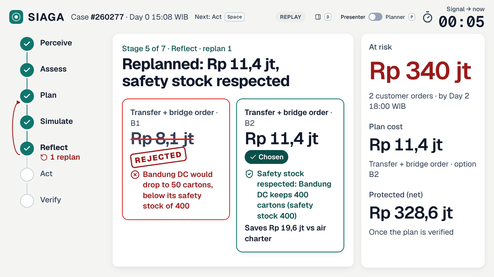
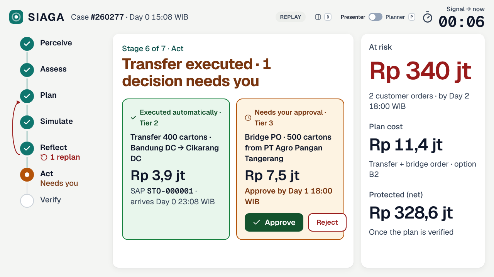
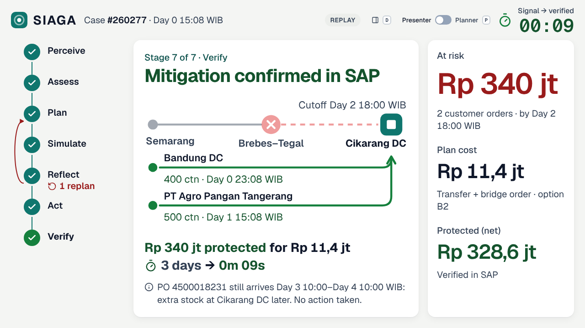
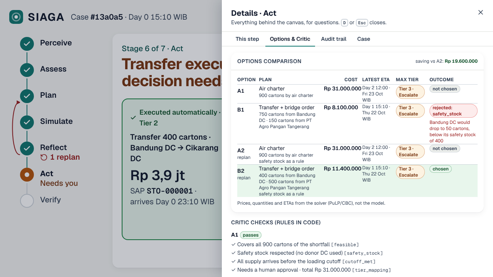
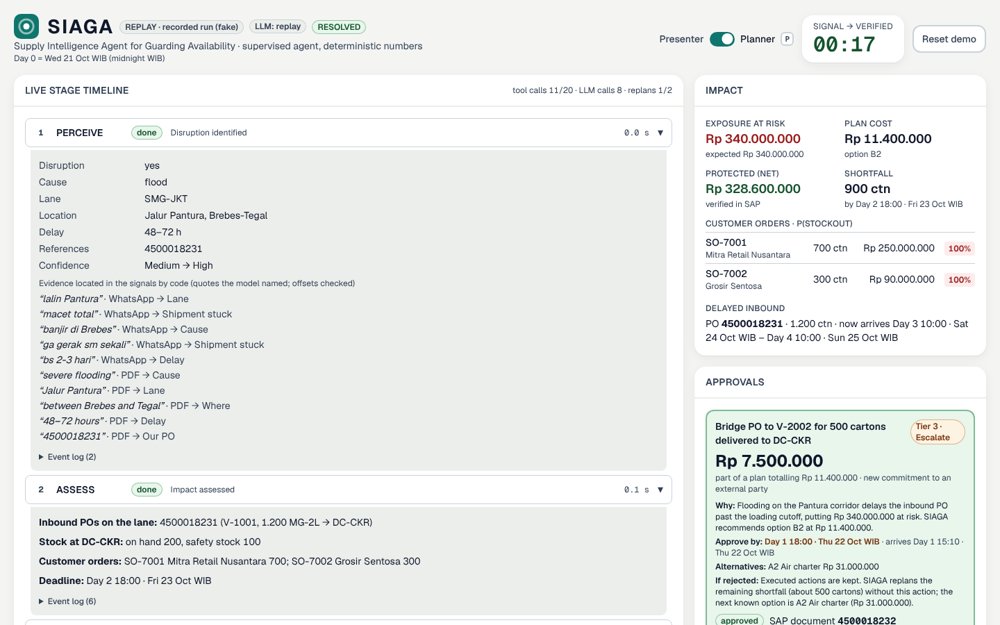
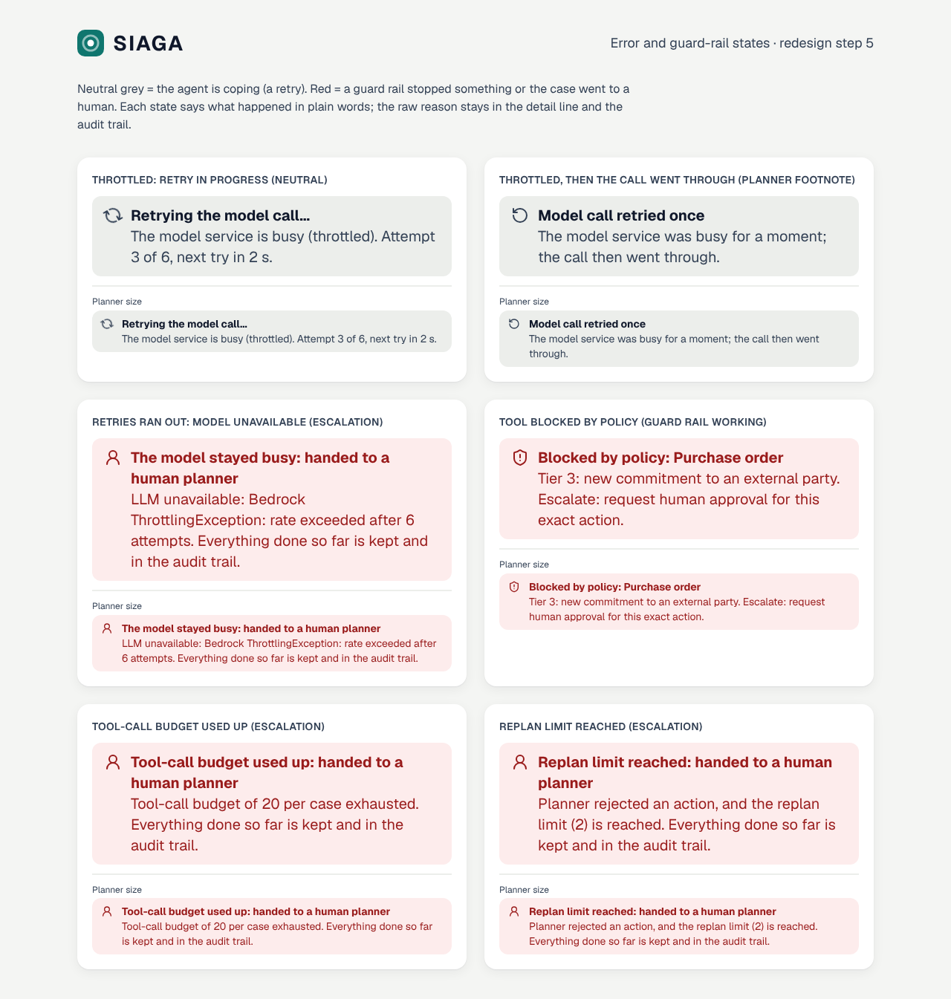
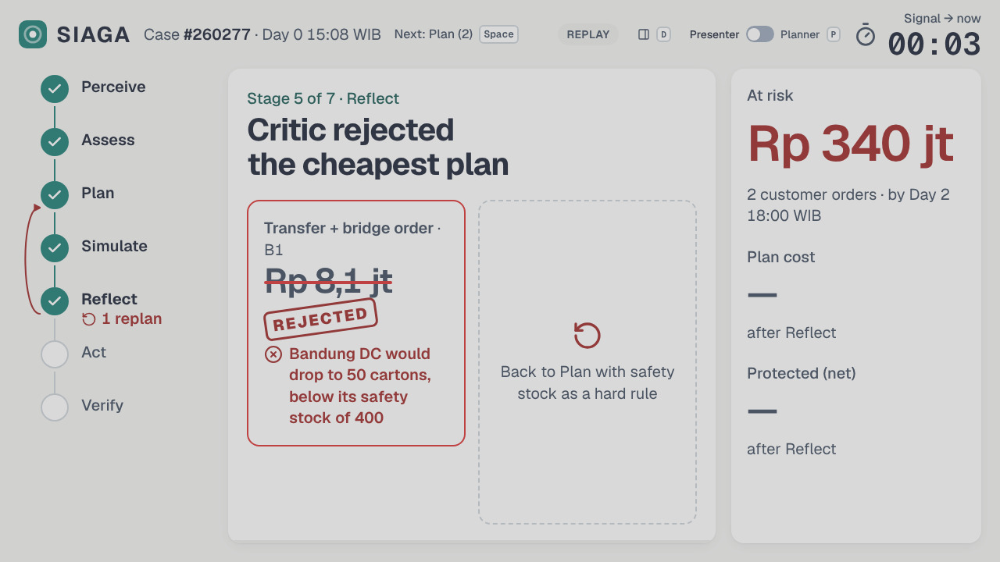

# SIAGA — Supply Intelligence Agent for Guarding Availability

Hackathon prototype of a supervised AI agent for Indonesian FMCG supply chains: it reads
informal disruption signals, maps them to POs, SKUs and customer orders, costs mitigation
options with a deterministic solver, auto-executes low-risk actions and escalates the rest
to a human planner.

See [CLAUDE.md](CLAUDE.md) for how to run, configuration, architecture and decisions.

```bash
uv sync && make test
```

## Screenshots

Presenter mode (projector, 1280×720), one stage at a time, from the replay of the demo case:

| | |
| --- | --- |
|  Perceive: slang in the driver's WhatsApp, located by code, linked to the fields it produced; confidence Medium → High |  Assess: Rp 340 jt at risk on 2 customer orders |
|  Reflect: the Critic rejects the cheapest plan (Bandung DC below safety stock) |  Reflect after the replan: Rp 11,4 jt, safety stock respected |
|  Act: Tier 2 transfer executed, Tier 3 bridge PO waits for one click |  Verify: confirmed in SAP; Rp 340 jt protected for Rp 11,4 jt |

| | |
| --- | --- |
|  Details drawer (`D`): solver table, Critic checks, audit trail |  Planner mode (`P`): the dense view for Q&A |
|  Error and guard-rail states (`/design/states`) |  Projector check: the same screen at 30% less contrast |

The golden run in the screenshots is the placeholder recording from the scripted (fake) LLM; see CLAUDE.md, Open items.
