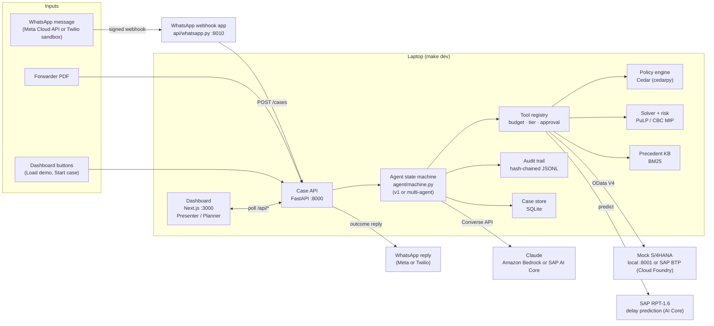
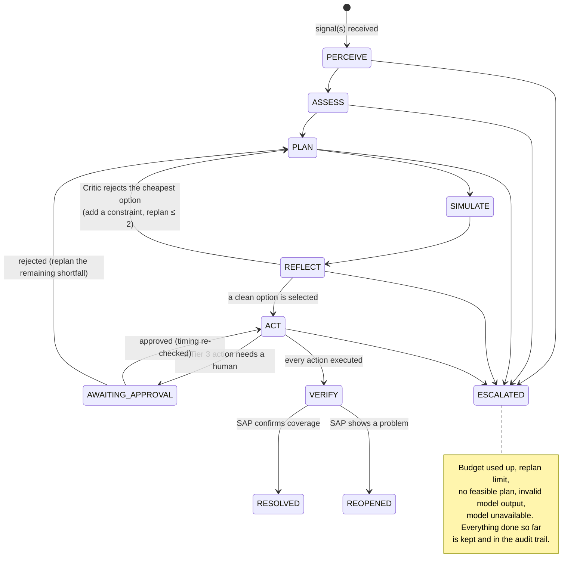
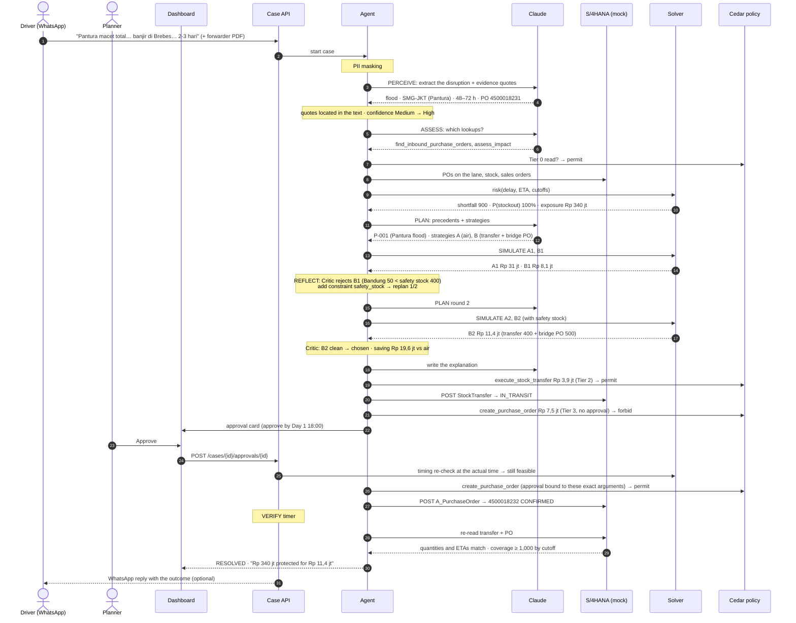
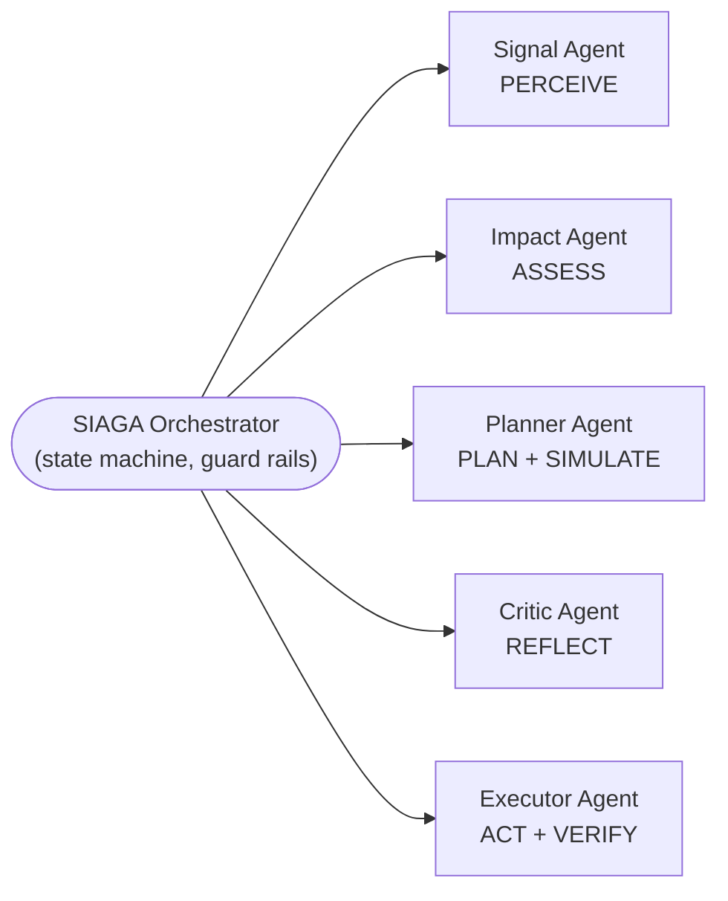

# SIAGA: the AI agent and how it works

**SIAGA** (Supply Intelligence Agent for Guarding Availability) is a supervised AI agent for
Indonesian FMCG supply chains. It reads informal disruption signals, such as a truck driver's
WhatsApp message in Bahasa slang or a forwarder's PDF notice. It finds the purchase orders,
stock and customer orders the disruption puts at risk, and prices the mitigation options with a
deterministic solver. It carries out the low-risk actions in SAP by itself and asks a human
planner to approve the rest. Then it checks in SAP that the fix really worked.

A disruption that usually takes a planning team about **three days** of calls, spreadsheets and
e-mails is handled in **minutes**. Every number comes from SAP or the solver, every action
passes a policy check, and every step is recorded in a tamper-evident audit trail.

> Hackathon prototype for Demo Day, 31 October 2026. How to run it and every design decision:
> [CLAUDE.md](../CLAUDE.md). Demo-day steps: [demo-day-runbook.md](demo-day-runbook.md).

---

## Contents

1. [The problem](#1-the-problem)
2. [What SIAGA does, and what it never does](#2-what-siaga-does-and-what-it-never-does)
3. [The demo scenario](#3-the-demo-scenario)
4. [Architecture](#4-architecture)
5. [The workflow, stage by stage](#5-the-workflow-stage-by-stage)
6. [Humans in the loop: tiers and approvals](#6-humans-in-the-loop-tiers-and-approvals)
7. [Multi-agent mode](#7-multi-agent-mode)
8. [Guard rails](#8-guard-rails)
9. [Integrations](#9-integrations)
10. [The dashboard](#10-the-dashboard)
11. [Run modes and how to start it](#11-run-modes-and-how-to-start-it)
12. [Status: what is live and what is a placeholder](#12-status-what-is-live-and-what-is-a-placeholder)
13. [Repository map](#13-repository-map)

---

## 1. The problem

In Indonesian FMCG distribution, the first warning of a disruption rarely arrives as a
structured system event. It arrives as a driver's WhatsApp message ("Pantura macet total,
banjir di Brebes…"), a phone call, or a forwarder's PDF. A planner then has to:

1. work out which shipments are affected;
2. find the purchase orders, stock positions and customer orders involved in SAP;
3. estimate the penalty if orders miss their loading cutoff;
4. find and price alternatives (internal transfers, alternate suppliers, air freight, moving a
   customer's delivery date);
5. check business rules such as safety stock, Incoterms and supplier capacity;
6. get approvals and create the documents in SAP;
7. check later that the fix holds.

That usually takes days, and by then the cheapest options are gone.

## 2. What SIAGA does, and what it never does

| SIAGA does | SIAGA never does |
| --- | --- |
| Turns unstructured signals (WhatsApp slang, PDFs) into a structured disruption, with the exact phrases it relied on | Compute a number with the language model: costs, quantities, probabilities and dates come from SAP, the risk function and the solver |
| Finds the affected POs, stock and sales orders in SAP through tools | Act without a policy decision: every action is checked by the Cedar policy engine **and** again in code |
| Prices options with a MIP solver and has a Critic check business rules | Take a high-risk action without a human: Tier 3 actions wait for one-click approval |
| Executes low-risk, reversible, internal actions in SAP by itself (Tier 2) | Exceed its budget: at most 20 tool calls and 2 replans per case, enforced in code |
| Replans when the Critic or a human rejects a plan | Hide its work: every step, tool call, model call and decision is in a hash-chained audit trail |
| Verifies the result in SAP and re-opens the case if the fix did not hold | Guess: when the evidence or a business number is missing, it escalates to a human |

## 3. The demo scenario

Every number below is seeded in the mock S/4HANA (`data/seed/`) and asserted in the tests.

**Situation (Day 0).** A flood near Brebes blocks the Pantura corridor. A truck carrying PO
**4500018231** (1,200 cartons of *Minyak Goreng 2L* from PT Sumber Pangan Semarang, due at
Cikarang DC on Day 1 10:00) is stuck.

**What is at risk.** Two customer orders load at **Cikarang DC (DC-CKR)** by **Day 2 18:00 WIB**:

| Order | Customer | Cartons | If missed |
| --- | --- | ---: | ---: |
| SO-7001 | Mitra Retail Nusantara (modern trade) | 700 | OTIF penalty Rp 250,000,000 |
| SO-7002 | Grosir Sentosa (wholesale) | 300 | lost margin Rp 90,000,000 |

Cikarang DC has 200 cartons on hand, but 100 of them are safety stock. Usable stock is 100
cartons against 1,000 needed, so the **shortfall is 900 cartons**. The **exposure is
Rp 340,000,000**, with a 100% stockout probability.

**Options the agent can find in SAP:**

| Source | Facts (from SAP) |
| --- | --- |
| Bandung DC (DC-BDG), not on Pantura | 800 on hand, safety stock 400; truck lane BDG→CKR: 250 cartons per truck, Rp 1,950,000 per truck, 8 h, internal and reversible |
| PT Agro Pangan Tangerang (V-2002), alternate supplier | 1-day lead time, capacity 600 cartons, premium Rp 15,000 per carton, DDP |
| Air charter quote Q-AIR-0001 | flat Rp 31,000,000 for the whole shortfall, delivered Day 2 12:00 |

**The golden outcome:**

| Option | Plan | Cost | Result |
| --- | --- | ---: | --- |
| B1 | transfer 750 from Bandung + bridge PO 150 | Rp 8,100,000 | **Rejected by the Critic**: Bandung DC would drop to 50 cartons, below its safety stock of 400 |
| A | air charter | Rp 31,000,000 | clean, but expensive (the comparison baseline) |
| **B2** (after one replan) | **transfer 400 from Bandung (2 trucks) + bridge PO 500 from V-2002** | **Rp 11,400,000** | **Chosen**: Rp 19,600,000 cheaper than air, safety stock respected |

The transfer (Rp 3,900,000) is Tier 2, so SIAGA executes it at once. The bridge PO
(Rp 7,500,000) is a commitment to an outside supplier, so it is Tier 3: it waits for a planner's
approval, which must come by **Day 1 18:00**. After approval SIAGA creates PO **4500018232**
and later verifies the result in SAP.

Final line on screen: **"Rp 340 jt protected for Rp 11,4 jt"**. Net protected:
Rp 328,600,000.

## 4. Architecture



| Component | Where | What it does |
| --- | --- | --- |
| **Case API** | `api/app.py` | Starts cases (`POST /cases`), serves cases, events and the audit trail, takes approval decisions, runs the VERIFY scheduler, sends the WhatsApp outcome reply |
| **Agent state machine** | `agent/machine.py` | Runs the seven stages in a fixed order and enforces budget, replans and escalations |
| **Multi-agent orchestrator** | `agent/multi/` | Optional (`ORCHESTRATION=multi`): five specialist agents built with Strands Agents, on the same state machine |
| **Tools** | `agent/tools/` | Every call to SAP, the solver or the knowledge base goes through `ToolRegistry.invoke` |
| **Policy** | `policy/siaga.cedar` | Cedar rules that permit or forbid each tool call by tier |
| **Critic** | `agent/critic.py` | Deterministic business rules: feasibility, safety stock, Incoterm, supplier capacity, cutoff, tier mapping |
| **Solver** | `services/solver/` | Stockout risk, the MIP that prices options, comparison, timing re-checks |
| **Mock S/4HANA** | `services/sap_mock/` | OData-V4-shaped API with POs, stock, sales orders, suppliers, lanes, quotes; runs locally or on SAP BTP |
| **LLM providers** | `agent/providers/` | Bedrock, SAP AI Core (`sap_genai`), fallback, replay, recording, and a scripted `fake` |
| **Delay model** | `agent/delay_model.py` | SAP RPT-1.6 delay prediction, combined with the signal's delay range |
| **Audit** | `agent/audit.py` | Append-only JSONL per case; each entry carries the hash of the previous one |
| **Dashboard** | `web/` | Presenter mode for the projector, Planner mode for detail |
| **WhatsApp webhook** | `api/whatsapp.py` | The only thing exposed to the internet: checks signatures, allowlist and duplicates, then forwards to the Case API |

## 5. The workflow, stage by stage

### 5.1 The case lifecycle



The legal transitions are a table in code (`agent/machine.py`). The model cannot skip or
reorder a stage.

### 5.2 Who does what in each stage

| Stage | The language model | Code (deterministic) | Tools | Output |
| --- | --- | --- | --- | --- |
| **1. PERCEIVE** | Reads the signals and fills `report_disruption`: cause, lane, location, delay range, affected PO, and the evidence quotes it relied on | PII masking before any model call; validates the output; **finds each quote in the original text** (quotes it cannot find are dropped); computes confidence (one informal source = Medium, plus an agreeing official source = High) | `extract_pdf_text` (multi mode) | Structured disruption with highlighted evidence |
| **2. ASSESS** | Chooses which lookups to make | Refuses a risk call whose delay differs from PERCEIVE's; optionally asks SAP RPT-1.6 for a delay prediction and combines it with the signal range; runs the risk function | `find_inbound_purchase_orders`, `assess_impact` (v2: `find_open_pos`, `get_sales_orders`, `get_stock`, `compute_risk`, `predict_delay`) | Affected PO, orders at risk, shortfall, stockout probability, exposure |
| **3. PLAN** | Searches precedents and proposes **strategies only** (no numbers), e.g. "transfer + alternate supplier", "air" | Removes strategies that were ruled out (e.g. after a rejection) | `search_precedents` | Candidate strategies and cited precedents |
| **4. SIMULATE** | — (multi mode: the Planner chooses which candidates to run) | One solver call per candidate with the case's active constraints | `simulate_option` / `run_solver` | Priced options: actions, quantities, cost, arrival times, tier |
| **5. REFLECT** | Writes the plain-language explanation from the results it is given (amounts pre-formatted) | **Critic** runs every rule; selects the cheapest clean option; if the cheapest fails a fixable rule, adds the constraint and replans; builds the comparison against the air baseline | `check_business_rules` (multi) | Chosen option, rejected options with a template sentence, saving, net protected |
| **6. ACT** | Writes the approval card summary (multi mode) | Maps each action of the chosen plan to a tool call, computes its tier, executes Tier ≤ 2, raises an approval card for Tier 3, adds Tier 0 notes | `execute_stock_transfer`, `create_purchase_order`, `book_spot_air`, `reschedule_customer_order`, `request_human_approval` | Executed SAP documents and pending approvals |
| **7. VERIFY** | — | After `VERIFY_DELAY_SECONDS`, re-reads every executed document in SAP; checks quantities, statuses, arrival times and coverage | `get_action_status` / `check_status` | RESOLVED, or REOPENED with the reason |

### 5.3 End-to-end sequence (the golden run)



### 5.4 Alternative paths

**The planner rejects the bridge PO.** The rejection takes an optional reason, which the
agent reads in the replan. The transfer that already ran is kept. V-2002 is excluded, and the
remaining 500 cartons are replanned. That counts as one replan and usually produces an air
charter option, which is a new Tier 3 approval. The case cost becomes Rp 34,900,000
(air Rp 31 jt + the Rp 3,9 jt transfer already spent). If nothing feasible remains, or the
replan limit is reached, the case is escalated.

**The approval comes too late.** At approval time the solver re-checks timing against the real
clock. After the approve-by time (Day 1 18:00 for the bridge PO), the approval is marked
EXPIRED and the agent replans.

**VERIFY finds a problem.** If a transfer is delayed or a PO is cancelled in SAP, VERIFY fails
and the case becomes **REOPENED**, with a red banner on the dashboard. A hidden fault injection
(`POST /demo/inject`) demonstrates this. It is not in the UI.

**The model misbehaves or is unavailable.** An invalid structured output is sent back with
the validation error and one nudge. After 5 turns the case escalates. If the model never
completes ASSESS, a deterministic fallback makes the same lookups (visible as an event).
Throttling is retried and shown as "Retrying…". If Bedrock refuses the case at its start, it
can move to Claude on SAP AI Core (`LLM_FALLBACK=sap_genai`).

## 6. Humans in the loop: tiers and approvals

Every tool declares the facts behind its tier, computed from its arguments and SAP data, never
supplied by the model: observe-only, draft-only, internal, reversible, external commitment,
spot air, SLA change, amount.

| Tier | Meaning | Examples | What happens |
| --- | --- | --- | --- |
| **0** | Observe | SAP reads, risk, precedents, simulation, status checks; notes such as "PO 4500018231 will still arrive, Day 3–4" | runs |
| **1** | Draft | an RFQ draft | runs, nothing sent |
| **2** | Execute: internal, reversible, under Rp 50 jt | the Bandung → Cikarang stock transfer | **runs automatically** |
| **3** | Needs a human | Rp 50 jt or more, any external commitment (a PO), spot air, an SLA change (rescheduling a customer order) | **approval card**: what, why, cost, alternatives, what happens if rejected, approve-by time |

**How an approval binds.** An approval is tied to the exact tool and a hash of its exact
arguments. A different quantity or supplier is not covered. The approval ID is also the SAP
idempotency key, so a retried call never creates a second PO.

## 7. Multi-agent mode

With `ORCHESTRATION=multi` the same state machine hands each stage to a specialist agent
(Strands Agents). Stage order, budget, Critic rules, selection, approvals, ACT and VERIFY stay
in code.



| Agent | Allowed tools (anything else is a hard error and escalates) | Writes |
| --- | --- | --- |
| Signal | `extract_pdf_text` | the disruption, plus an English gloss under each Bahasa phrase |
| Impact | `find_open_pos`, `get_sales_orders`, `get_stock`, `compute_risk`, `predict_delay` | a one-sentence impact note |
| Planner | `search_precedents`, `run_solver` (strategies only; code applies the constraints) | candidate strategies |
| Critic | `check_business_rules` (deterministic), `report_review` | notes on failing options, the explanation |
| Executor | `create_stock_transfer`, `request_approval`, `create_purchase_order`, `book_spot_air`, `reschedule_customer_order`, `check_status` | the approval card summary only (the actions are the chosen plan, executed by code) |

Every model call still goes through one function (`Agent._llm`), so recording, replay, retries,
audit and the call counter are the same in both modes. The dashboard names the agent on each
stage of the rail.

## 8. Guard rails

| Guard rail | How it is enforced |
| --- | --- |
| **No model arithmetic** | Costs, quantities, probabilities and dates come from SAP, `services/solver` and `agent/critic.py`. The model gets pre-formatted amounts to explain. The Critic's sentence is a code template filled with solver numbers |
| **Evidence is checked** | Each evidence quote must be found in the signal text (case- and whitespace-normalised). Quotes that cannot be found are dropped and logged; the UI highlights only located spans |
| **Confidence is computed** | From located evidence per field, the same every run; shown as Medium / High, never a percentage |
| **Policy, twice** | Cedar decides from the tool's facts; the tool's `guard()` recomputes the tier and looks up the approval again in code. An exhaustive test proves the two agree on 768 fact combinations × 3 amounts |
| **Budget** | At most 20 tool calls per case (`MAX_TOOL_CALLS`); the call that would exceed it is refused and the case escalates |
| **Replan cap** | At most 2 replans (`MAX_REPLANS`), including those caused by rejections |
| **Bounded model turns** | 5 turns per stage (multi: 5 + a 2-turn nudge), then escalation |
| **Allowlists** | In multi mode each specialist can call only its own tools; a violation is audited and escalates |
| **Audit trail** | `var/audit/<case>.jsonl`: every stage change, model call (with prompt version), tool call, policy decision, approval and notification. `hash = sha256(entry)`, chained by `prev_hash`; the dashboard shows whether the chain verifies |
| **PII masking** | `PII_MASKING=local`: phone numbers, e-mails and names (after Pak / Bu / Sopir: …) are masked before any model call; the original is only in the audit trail |
| **Secrets** | Never in git, chat or logs; `.env.*` files are git-ignored and written with hidden input; a leak check (gitleaks) runs before commits |
| **Exposure to the internet** | Only the WhatsApp webhook (port 8010) goes through the tunnel; it checks signatures, the sender allowlist, duplicates and age. Approve and reset stay on the laptop |

## 9. Integrations

| Integration | Switch | Notes |
| --- | --- | --- |
| **Claude on Amazon Bedrock** | `LLM_PROVIDER=bedrock`, `BEDROCK_MODEL_ID` | Converse API with tool use; temperature 0; visible throttling retries |
| **Claude on SAP AI Core** (Generative AI Hub) | `LLM_PROVIDER=sap_genai`, or `LLM_FALLBACK=sap_genai` | Model `anthropic--claude-4.6-sonnet`; deployment looked up via AI Core; the same Converse body. As a fallback it takes over a case only if Bedrock refuses its first call, and the UI says "Model: Claude via SAP AI Core" |
| **SAP RPT-1.6** | `DELAY_MODEL=rpt` | Predicts the delay in hours from 80 past disruptions. A prediction inside the signal's range is used as a point; outside, it is clamped and flagged; unavailable falls back to the range. Never an escalation |
| **Mock S/4HANA on SAP BTP** | `SAP_MOCK_ON_BTP=1` | Cloud Foundry app `siaga-sap-mock`, protected by an API key |
| **WhatsApp (Meta Cloud API)** | `WHATSAPP_INBOUND=1`, `WHATSAPP_PROVIDER=meta` | A message from an allowed phone opens a case; `WHATSAPP_NOTIFY=1` sends the outcome back |
| **WhatsApp (Twilio sandbox)** | `WHATSAPP_PROVIDER=twilio` | The same, without a Meta app |
| **Replay** | `LLM_PROVIDER=replay` / `make replay` | Plays a recorded run with no network; labelled REPLAY in the UI |

Feature flags and their state: [v2-flags.md](v2-flags.md). Where every value lives:
[connections.md](connections.md).

## 10. The dashboard

**Presenter mode** (default, for a projector at 1280×720):

- one stage at a time;
- a rail on the left with the seven stages (and the agent names in multi mode);
- an impact meter on the right (at risk / plan cost / protected net);
- a live clock from signal to verified.

Each stage has its own canvas:

| Stage | What the canvas shows |
| --- | --- |
| Perceive | The WhatsApp bubble and the PDF phrases light up, and lines connect each phrase to the field it produced; confidence moves Medium → High |
| Assess | The lane map with the blocked corridor, the stuck PO, the orders at risk turning red, stockout probability counting up to 100% |
| Plan | Strategy chips and cited precedents (synthetic) |
| Simulate | Priced option cards, labelled "calculated by the solver, not AI" |
| Reflect | The REJECTED stamp on the cheapest card with the Critic's sentence; the replanned option slides in |
| Act | The executed transfer next to the approval card; one click turns it from amber to green and shows the SAP PO number |
| Verify | The lane after mitigation, coverage, the final line "Rp 340 jt protected for Rp 11,4 jt", and the Tier 0 note |

**Keys and views:**

- Pacing: each stage stays at least 5 s. `Space`/`→` next, `←` back, `H` hold, `R` restart the
  view, `L` live.
- `D` opens the details drawer: tool calls, the options and Critic table, the audit trail, case
  facts, reset.
- **Planner mode** (`P`) is the dense view with every stage expanded. It also has an
  **Architecture** tab built from the live configuration.

The UI does no money arithmetic: every number is formatted from backend values. The colours
pass a projector washout check (contrast reduced by 30%).

## 11. Run modes and how to start it

| Mode | Command | Model | SAP | When |
| --- | --- | --- | --- | --- |
| **Laptop live** (Demo Day default) | `make use-local` → `make dev` | Bedrock or Claude on SAP AI Core | BTP mock + RPT-1.6 | default |
| **Replay** | `make use-replay` → `make dev` | the recorded run | local mock | no network, or a live service misbehaves |
| **v1** | `make use-v1` → `make dev` | Bedrock | local mock, no RPT | the v2 path misbehaves |
| **Fake** (development, tests) | `LLM_PROVIDER=fake make dev` | scripted | local mock | no credentials |

```bash
uv sync && (cd web && npm ci)
scripts/fill-env.sh        # once: writes .env.local etc. with hidden input
make use-local
make preflight             # one line per connection, green / amber / red
make dev                   # mock SAP :8001, Case API :8000, dashboard :3000
open http://localhost:3000 # Load demo WhatsApp → Load forwarder PDF → Start case → Approve
```

Other useful commands:

- `make test`: the Python tests.
- `make web-smoke`: browser end-to-end tests.
- `make rehearse N=10`: the full demo N times through the API, with timings.
- `make rehearse-fault N=3`: the REOPENED path.
- `make record-golden`: record a real run for replay.

## 12. Status: what is live and what is a placeholder

| Area | State |
| --- | --- |
| Agent, tools, policy, Critic, solver, audit, Case API, dashboard | Built and tested (pytest, Playwright, rehearse 10/10) with the scripted model and replay |
| Multi-agent mode, RPT-1.6 integration, PII masking, BTP mock | Built and tested; the BTP mock is deployed by the owner |
| Claude on SAP AI Core + fallback | Built and tested against a simulated AI Core; a live ping has succeeded on the owner's laptop |
| WhatsApp inbound + reply (Meta and Twilio) | Built and tested with signed payloads and stand-in APIs; not yet tried with a real account |
| Golden recordings in `data/golden/` | **Placeholders from the scripted model**, labelled "(fake)" in the UI; to be re-recorded from a live run (`make record-golden`) |
| Bedrock | Blocked on the owner's account ("Operation not allowed"); SAP AI Core is used instead |
| AWS deployment (Phase 7) | Dropped; the secrets / SSM / health-check design stays documented |

Open items are tracked in [CLAUDE.md](../CLAUDE.md#open-items).

## 13. Repository map

```
agent/           state machine (machine.py), Critic, actions, evidence, PII, delay model,
                 audit, case store, KB, prompts/, providers/, tools/, multi/
api/             Case API (app.py), WhatsApp webhook (whatsapp.py), outcome reply
                 (whatsapp_notify.py), health checks (connections.py)
services/        sap_mock/ (OData mock S/4HANA), solver/ (risk + MIP)
policy/          Cedar policies and schema
siaga_common/    settings, timeline (Day N ↔ WIB/UTC), money formatting, config sources
data/            seed/ (SAP data), demo/ (signals, precedents), history/ (RPT rows),
                 golden/ (replay recordings)
web/             Next.js dashboard (Presenter, Planner, design system, e2e tests)
scripts/         preflight, rehearse, record-golden, env modes, fill-* setup scripts
deploy/btp/      Cloud Foundry files for the mock S/4HANA
docs/            this overview, runbook, connections, flags, WhatsApp, BTP deploy
tests/           pytest suite (golden numbers asserted)
```
